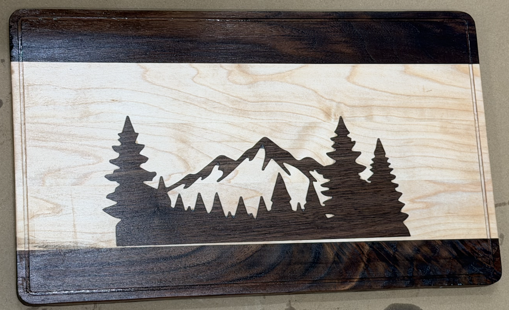
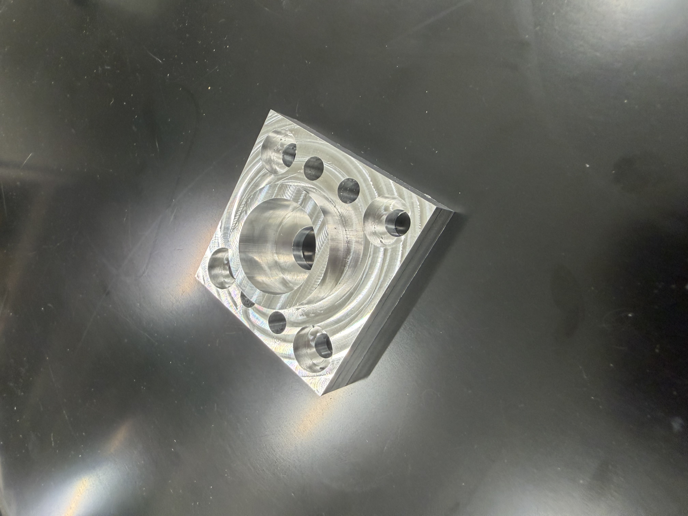
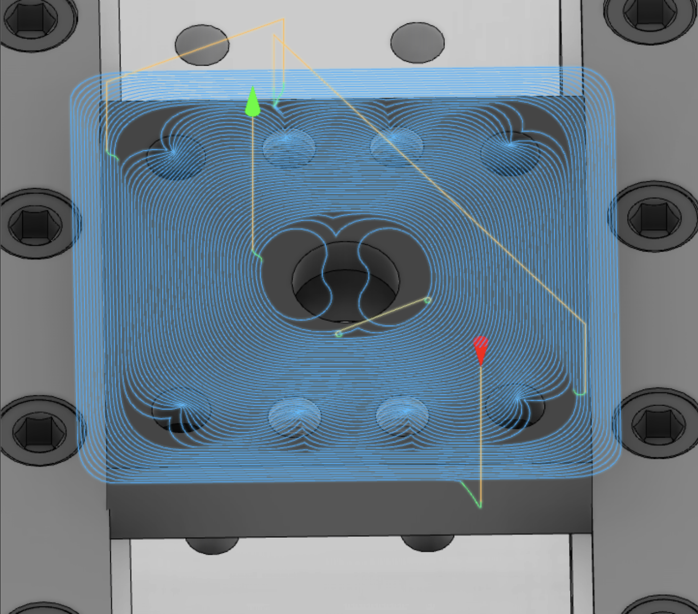
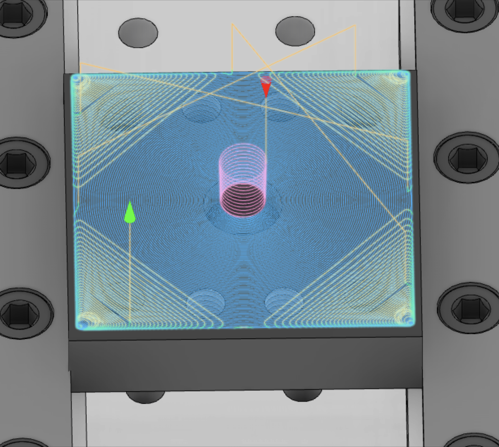

**Focus:** CAM Programming, CNC Machining & Subtractive Manufacturing  
**Software:** Autodesk Fusion 360  
**Processes:** CNC Wood Routing, CNC Metal Milling, Facing, Pocketing, Contouring, Roughing, Finishing, Drilling & Tapping  

---

## Project Overview

These two projects introduced me to **computer aided manufacturing in Fusion 360** and taught me how differently a toolpath has to be approached depending on the material, machine, tool, and final geometry.

I first developed CAM for a **CNC wood router** to manufacture an inlaid cutting board. I then moved to a **CNC metal mill**, where I machined an aluminum widget with significantly more complex toolpaths.

Working with both materials helped me understand that CAM is much more than telling a machine where to move. Every operation depends on correctly defining the **stock, work coordinate system, tools, machining boundaries, feeds and speeds, stepdowns, and order of operations**.

---

# CNC Wood Router

## Inlaid Cutting Board

My first major CAM project was designing and machining a custom wood cutting board using a CNC router.

I began by **gluing five pieces of wood together** to create the initial cutting-board blank. Because the individual pieces were not perfectly level after gluing, the first machining operation was to **face both sides of the board**.

Facing created two flat and parallel surfaces and established a consistent starting point for the rest of the machining operations.

The complete manufacturing process included:

1. Gluing five wood pieces into the initial blank.
2. Facing the first side of the board.
3. Flipping the board and facing the second side.
4. Cutting the pocket for the contrasting wood inlay.
5. Machining the juice groove.
6. Cutting the final outside profile of the board.
7. Machining the separate wood inlay.
8. Gluing the inlay into the machined pocket.
9. Sanding and finishing the board with oil.

---

## Designing the CAM

Each feature required a different CAM strategy.

The board was surfaced using a **facing operation**, while the inlay pocket required a pocketing toolpath. The outside shape of the board was machined using a **2D contour**, and tabs were added during the final cut to keep the board secured to the stock.

One of the most important design constraints came from the inlay.

I used a **1/16" downcut bit** to machine the inlay, which meant the cutter had a radius of **1/32"**. Because a round cutting tool cannot create an internal corner sharper than its own radius, I had to make sure that **none of the corners in my inlay design had a radius smaller than 1/32"**.

This forced me to think about manufacturability while I was still designing the geometry in CAD. A shape may look completely valid on the computer, but if an internal corner is tighter than the radius of the tool, the CNC router physically cannot reproduce it.

This was especially important because an **external corner on the pocket becomes an internal corner on the matching inlay**. I had to check both pieces of geometry and add appropriate fillets so that the 1/16" cutter could physically reach every feature.

I also made the inlay slightly smaller than the pocket to provide enough clearance for assembly and glue.

This project helped me understand that CAM starts before the toolpath is generated. The **tool diameter, cutter geometry, and machining process all influence how the original CAD model should be designed**.

## CAM Toolpaths

The interactive model below includes the CAM setup used to machine the part. Open the **CAM** tab in the viewer and select individual operations to view the corresponding toolpaths.

<iframe
  src="https://a360.co/4AKM025?mode=embed"
  width="100%"
  height="700"
  allowfullscreen="true"
  webkitallowfullscreen="true"
  mozallowfullscreen="true"
  frameborder="0">
</iframe>

---

## Learning the Importance of the Machine Origin

One of the biggest lessons from this project came from something that initially seemed very small:

### **Setting the origin correctly.**

Before machining, the machine needs an accurate reference location that connects the physical piece of material to the coordinate system used in Fusion 360.

I learned very quickly that being only slightly off when setting this origin can create a noticeable error in the final part.

My finished cutting board shows this lesson.

The mountain inlay is **slightly crooked relative to the rest of the board**. The error is small, but because the inlay pocket and later operations rely on the same coordinate system, a small difference in machine zero became visible across the final piece.

Rather than hiding the mistake, I think it is one of the most useful parts of this project because it made the importance of **work coordinate systems, machine setup, and repeatability** very tangible.

A perfect CAM program cannot compensate for an incorrectly established physical reference point.

---

# CNC Metal Mill

## Aluminum Widget

After learning the fundamentals of CAM on the wood router, I moved to a CNC metal mill and machined an **aluminum widget**.

Although many of the basic ideas were the same, machining aluminum required a much more deliberate CAM strategy.

The widget contained multiple levels, circular pockets, drilled features, and holes that would ultimately be tapped. Instead of simply removing material until the final geometry was reached, I had to think carefully about **how the material should be removed**.

---

## Roughing & Finishing

One of the biggest differences between the wood and metal projects was the separation between **roughing and finishing operations**.

For the aluminum part, I first used roughing operations to efficiently remove most of the excess stock while intentionally leaving a small amount of material behind.

The finishing operations then removed that remaining material and produced the final geometry and surface finish.

This allowed me to balance two competing goals:

### **Remove material efficiently without putting unnecessary load on the cutting tool.**

The machining sequence also included operations for the holes that would be tapped, requiring me to plan not only the geometry of the finished part but also the order in which the manufacturing operations occurred.

---

## Tool Engagement Matters

Machining metal made me much more conscious of what the cutting tool was experiencing throughout the toolpath.

With wood, there is generally much more tolerance for aggressive material removal.

With aluminum, a poorly planned toolpath can quickly overload or break an end mill.

Instead of prioritizing the shortest possible machining time, I learned to prioritize **consistent chip engagement and controlled tool loading**.

The tool should ideally remove material at a predictable rate rather than suddenly entering a large amount of stock.

This made toolpath simulation much more important because I needed to understand not only where the tool would travel, but also **how much material the cutter would encounter throughout that motion**.

---

## Breaking a Tool

One of the most valuable lessons from this project came from an actual machining failure.

While programming a roughing operation on the back side of the widget, I selected the **face of the part instead of the intended outside machining boundary**.

Fusion generated a valid toolpath, and at first glance the operation appeared reasonable.

However, the geometry selection changed how Fusion interpreted the area that needed to be cleared.

  

    

    

      <strong>Original Toolpath:</strong> Incorrect machining boundary caused excessive tool engagement near the center of the part.
    

  

  

    

    

      <strong>Improved Toolpath:</strong> Correcting the machining boundary created a more controlled roughing path with consistent tool engagement.
    

  

During machining, the toolpath attempted to remove too much material near the center of the part at once.

The cutting forces became too high and:

### **I broke the end mill.**

That mistake completely changed the way I review CAM.

I learned that a toolpath being successfully generated by Fusion does **not** mean it is necessarily a good toolpath.

The programmer is still responsible for understanding:

- Why the tool is moving where it is moving
- How much material it is removing
- Where the cutter is engaging the stock
- Whether the selected machining boundary is actually correct
- Whether the tool can physically handle the resulting cut

After identifying the problem, I corrected the machining boundary and regenerated the roughing strategy with more appropriate material engagement.

---

## Comparing Wood & Metal CAM

These projects helped me see how the same CAM software can require very different thinking depending on the manufacturing process.

| CNC Wood Router | CNC Metal Mill |
|---|---|
| Work coordinate accuracy strongly affected alignment | Tool loading strongly affected machining strategy |
| Facing created a flat reference surface | Roughing and finishing were separated |
| Pocketing created the inlay cavity | Material removal required controlled engagement |
| Tool radius constrained the inlay geometry | Tool engagement affected tool life |
| Contouring defined the final board shape | More complex geometry required additional machining operations |
| Small zeroing errors became visible in the finished part | Incorrect machining boundaries could cause tool failure |

The cutting board taught me the importance of **setup, coordinate systems, and designing around tool geometry**.

The aluminum widget taught me the importance of **toolpath strategy, cutting forces, chip engagement, and machining boundaries**.

Together, they helped me move from simply knowing how to generate a CAM operation to understanding **why a particular machining strategy should be used**.

---

## Reflection

These projects gave me hands-on experience taking a part through the complete workflow of:

### **CAD → CAM → Simulation → Machine Setup → CNC Machining → Finished Part**

More importantly, they taught me that CAM requires constant engineering judgment.

A small mistake when setting the machine origin can shift an entire operation. A corner that is perfectly valid in CAD may be impossible to manufacture with the selected tool. A small mistake when selecting geometry can completely change a toolpath. And a toolpath that looks correct on a computer screen can still fail once a cutting tool interacts with real material.

Working with both wood and aluminum gave me experience with **Fusion 360 CAM, CNC setup, work coordinate systems, design for manufacturing, facing, pocketing, contouring, roughing, finishing, drilling, tapping, tool selection, machining boundaries, tool engagement, and toolpath simulation**.

The biggest lesson I took away is that successful CNC machining depends on understanding the relationship between the **CAD geometry, digital toolpath, cutting tool, material, and physical machine**.
